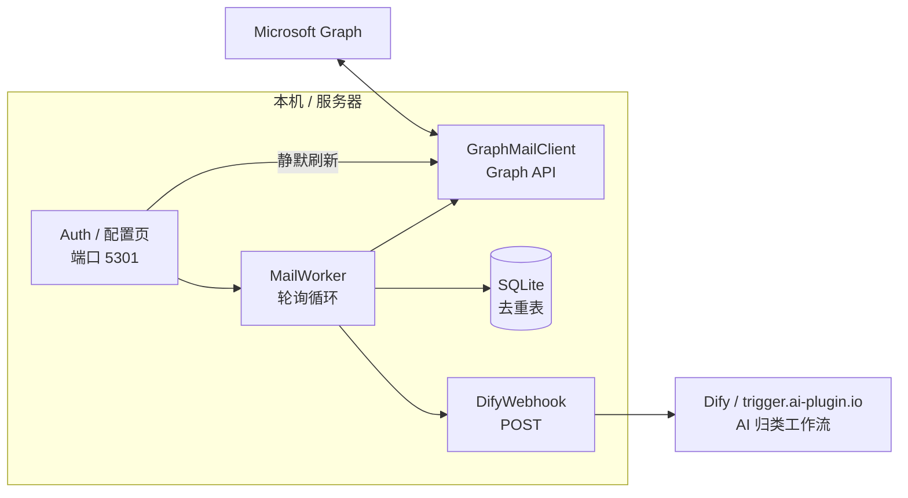
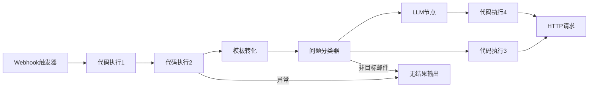
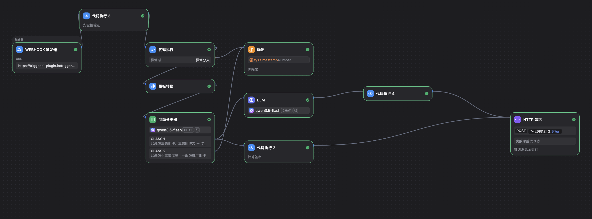

+++
date = '2026-10-26T00:26:48+08:00'
draft = false
title = 'Email Assistant'
tags = ['自动化', 'AI', 'Dify', '邮件', 'Python']
+++

# Email Assistant

这个项目是一个将 Outlook 中的邮件生成总结并发送到钉钉的工作流。

## 项目架构

项目由两部分组成：运行在服务器上的 Python 服务端，以及部署在 Dify Cloud 上的 Dify Workflow。服务器端负责拉取 Outlook 邮件，通过 Webhook 推送到 Dify Workflow；Dify 处理后，再通过 Webhook 将**邮件总结**推送到用户的钉钉机器人。

### 服务端架构

MailHub 是一个单用户桥接服务：通过 Microsoft Graph 轮询个人 Microsoft 账号的收件箱，
把每封新邮件以 HTTP Webhook 形式转发给下游 AI 工作流（Dify）进行归类。
没有数据库服务端、没有框架、没有消息队列——一个 Python 进程 + 一个 SQLite 文件。

Auth 用 OAuth 2.0 授权码 + PKCE（MSAL）完成一次登录。刷新令牌只保存在
磁盘的 `data/token_cache.json`；访问令牌在每次调用 Graph 时静默刷新。
MailWorker 每隔 `poll_interval` 秒醒来，从 Graph 拉取最新 N 封收件箱邮件，
跳过 SQLite 里已记录的 ID，其余按时间顺序 POST 到 webhook。

#### 进程布局

`python -m mailHub.main` 在同一进程里启动两件事：

| 组件 | 线程 | 职责 |
| --- | --- | --- |
| `MailWorker.start()` | 守护线程 `mail-poller` | 轮询 → 去重 → 投递 |
| `serve(auth)` | 主线程 | 标准库 `ThreadingHTTPServer`，监听 `0.0.0.0:5301` |

### Dify Cloud

Dify Cloud 上运行一个 Dify Workflow，接受服务器上的 Python 服务推送过来的邮件：先使用*问题分类器*过滤**垃圾 / 不重要**邮件，然后使用*LLM 节点*生成总结，最后利用*钉钉 bot*的 *Webhook API* 推送到用户的钉钉。

Dify 编排如下：

节点说明：

- *Webhook 触发器*：接收来自服务端的邮件推送
- *代码执行 1*：利用 webhook 请求头中的 signature 和 timestamp 计算 payload 合法性（实际上目前仅用 timestamp 检验是否为新邮件，并未完整校验 signature）
- *代码执行 2*：将 webhook 的 payload 解析为 sender、title、content
- *模板转化*：将解析出的内容转换为统一的 output 文本
- *问题分类器*：根据 content 判断是否为目标邮件类型，决定进入 *LLM 节点* 还是 *无结果输出*
- *LLM 节点*：按给定提示词对 output 生成总结
- *代码执行 3*：利用密钥计算钉钉 bot 的 webhook URL（生成 Bearer token）
- *代码执行 4*：去除 *LLM 节点* 生成总结中的 Markdown 标记
- *HTTP 请求*：将 *代码执行 4* 处理后的总结内容，通过 *代码执行 3* 生成的 webhook URL 发送到用户的钉钉机器人
- *无结果输出*：处理无需输出的结果

Dify 编排截图如下：

