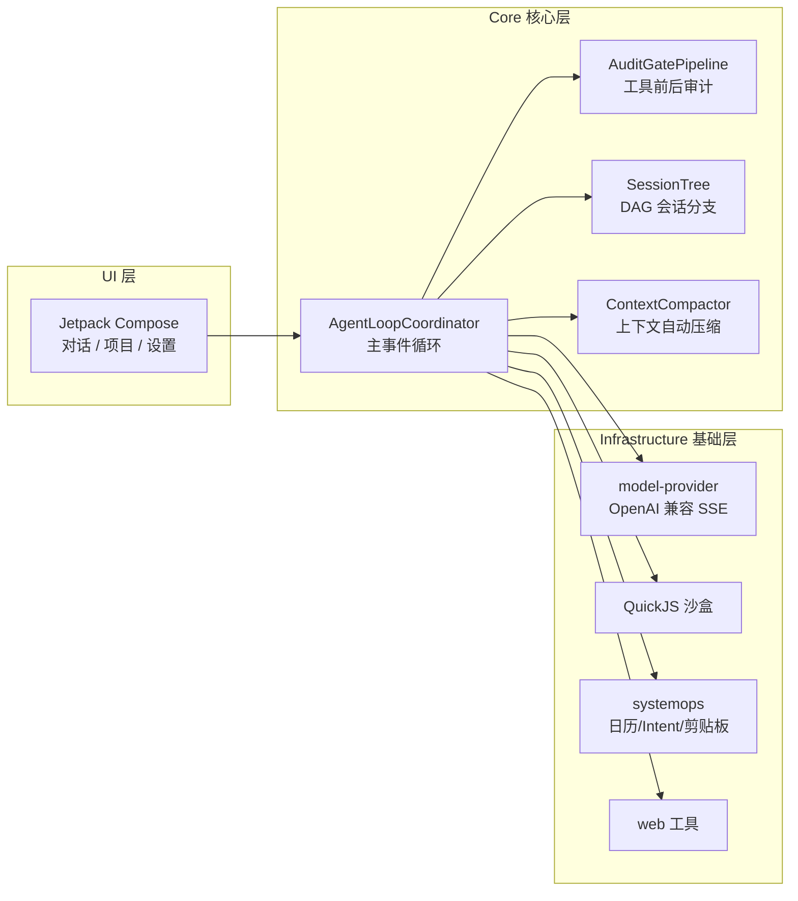

+++
date = '2026-10-07T14:43:59+08:00'
draft = false
title = 'SimplyWork 介绍'
+++

# SimplyWork 介绍

SimplyWork 是一款运行在 Android 设备上的聊天机器人，使用自然语言描述问题，它将调用 App 能力以及系统能力完成任务。

项目已开源：[github.com/facean2020/SimplyWork](https://github.com/facean2020/SimplyWork)

## 他是什么

SimplyWork 不是只会聊天的机器人，而是一个**会动手的助手**：

- 你说目标，它规划步骤；
- 需要时它调用手机的能力——日历、通知、剪贴板、定位、已装应用、文件；
- 每一步调用了什么、参数是什么、结果如何，都摊开在对话里给你看；
- 涉及敏感或不可逆的操作，它会先弹窗问你。

适用系统：**Android 14 及以上**。语言与界面使用 Kotlin + Jetpack Compose 编写。

```text
SimplyWork 本身不提供大模型，需要你自行提供一个大模型服务。
支持任意 OpenAI 兼容接口的模型提供商
只需要提供 服务商地址 + API Key 即可
```

## 设计哲学

与桌面端重型 Coding Agent（Claude Code 之类）不同，SimplyWork 的定位是**「个人意图分发与轻量数据胶水」**——不写代码、不做 AST 分析，而是把「你说的一句话」变成「手机上的一个动作」。

几条贯穿始终的设计原则：

- **极简 Harness 架构**：大模型只作为单步推理引擎，状态控制、上下文自愈、工具审计、沙盒执行全部由 Kotlin 原生脚手架确定性接管。模型幻觉再大，也翻不出脚手架画的圈。
- **移动原生元操作**：优先用 Android 自身的能力——日历 API、系统 Intent、剪贴板、通知，而不是模拟点击屏幕。
- **危险操作永远过人手**：删除文件必然确认，系统级操作有前置审计，敏感操作弹窗展示完整参数。
- **渐进式技能暴露**：技能初始化时只注入一句话简介（不到 100 token），命中场景才展开完整 Schema，节省上下文、减少幻觉。

## 系统架构



- **Core**：主事件循环按序驱动「注入 Prompt → 模型推理 → 工具审计 → 队列流转」；前置审计拦截高危参数，后置门禁做敏感数据校验；上下文超水位时自动把旧历史压缩成摘要节点。
- **Infrastructure**：模型层统一走 OpenAI 兼容接口 + SSE 流式；系统能力统一收口到 `SystemOperationRouter`，每个操作声明危险等级；脚本跑在隔离的 QuickJS 沙盒里，没有文件、网络和系统访问权限。

## 项目文件架构

```text
app/src/main/java/com/yangz3720/simplywork/
    MainActivity.kt / SimplyWorkApp.kt   # 入口与应用装配
    AppContainer.kt                      # 依赖注入容器
    ProviderKeyring.kt                   # 多服务商 API Key 管理
    core/                                # 核心控制层
        AgentRuntime.kt / AgentRunSupervisor.kt
        agent/
            AgentLoopCoordinator.kt      # 主事件循环协调器
            AuditGatePipeline.kt         # 工具前置/后置审计门禁
            CompletionGuard.kt           # 任务未闭环时阻止模型提前终止
            ContextCompactor.kt          # 上下文超限自动压缩
            MessageQueueManager.kt       # 运行中打断（转向）指令队列
            AgentSoul.kt                 # 按项目注入人格
            tool/                        # 工具注册与实现
                AgentToolRegistry.kt
                WebTools.kt / TtsTool.kt / TodoTool.kt
                ScriptTools.kt / WaitTool.kt
                SelfOpsTools.kt / SystemOpsToolAdapter.kt
        session/                         # 会话与项目
            SessionNode.kt / SessionTree  # DAG 树状分支
            ProjectStore.kt / SqliteSessionStore.kt
        attachment/                      # 图片与文档附件管线
        cloud/                           # OneDrive 同步引擎
        workspace/                       # 项目文件工作区 + 差异记录
    infrastructure/                      # 基础能力层
        model/                           # 模型 Provider（OpenAI 兼容）
            client/OpenAiCompatibleClient.kt
            config/ModelProviderPresets.kt
            DeviceCapabilityDetector.kt  # 硬件分级探测
        sandbox/engine/QuickJsSandbox.kt # JS 隔离沙盒
        systemops/                       # 系统能力收口
            SystemOperationRouter.kt
            tool/SystemOperationToolFactory.kt
            intent/SystemIntentExecutor.kt
        cloud/onedrive/                  # OneDrive 认证与 Graph API
        media/ preview/ error/ util/
    service/AgentRunService.kt           # 前台服务（后台运行）
    ui/                                  # Jetpack Compose 界面
        agent/                           # 对话、审批弹窗、附件、项目文件
        settings/ theme/
```

## 内置工具

助手能调用的工具全部向你公开，对话里每一步都能展开看到工具名、参数和返回值：

| 类别 | 工具 | 说明 |
|---|---|---|
| 时间 | `sys_time_read` `sys_time_calc` | 读当前时间、把「三天后」换算成准确时间 |
| 日历 | `sys_calendar_query` `sys_calendar_insert` | 查询日程、新建日历事件 |
| 应用 | `sys_app_list` `sys_app_open` `sys_deeplink_open` | 列出已装应用、启动应用、跳转链接 |
| 剪贴板 | `sys_clipboard_read` `sys_clipboard_write` | 读写剪贴板 |
| 系统 | `sys_notify_post` `sys_location_read` `sys_device_read` `sys_share_text` | 发通知、读定位、读设备信息、调起系统分享 |
| 文件 | `fs_read` `fs_write` `fs_list` `fs_mkdir` `fs_move` `fs_delete` | 项目工作区内读写整理文件（删除必然二次确认） |
| 脚本 | `js_run` `js_await` | 在 QuickJS 隔离沙盒里跑 JavaScript，可后台执行 |
| 联网 | `web_search` `web_fetch` | 搜索网页（Bing，DuckDuckGo 兜底）并读取页面 |
| 语音 | `tts_tool` | 用手机自带 TTS 引擎把文本文件合成为音频 |
| 任务 | `todo_write` `wait` | 维护待办清单保证任务闭环、等待后台脚本 |
| 自操作 | `self_config_read` `self_config_update` `self_project_create` `self_session_read` | 读改自己的配置、新建项目、查看历史会话 |

## 使用方法

### 对话即任务

在底部输入框描述目标，例如「下周三下午三点提醒我开会」「搜一下明天的天气」「看看今天有什么安排」。发送后：

- 底部显示「第 N 步 · 运行中」，实时展示进度；
- 每一步调用了什么工具、参数是什么、结果是什么，都可以展开查看；
- 回复内容**流式渲染**，模型生成到哪里就显示到哪里，尾部带闪烁光标；
- 完成后给出总结。

### 运行中还能改主意（转向）

助手正在跑的时候，你直接在输入框打字发送——这会变成一条**转向指令**，助手在下一步就调整方向，不必等它跑完再重来。

### 随时能停

运行中底部有「停止」按钮，点了立刻中断当前任务。

### 失败了能重试

如果模型服务限流或网络出错，底部会出现红色提示 +「重试」按钮，一键重开这一轮。

### 改历史提问 = 开新分支

长按对话里你之前发过的任意一条消息，可以修改后重新发送。原来的对话不会丢，而是变成一条平行的**分支**，用 `< 1/3 >` 这样的切换器来回查看。适合「同一个问题换几种问法试试」。

### 可以主动读取文件

在助手执行任务期间可以读取「项目」下的文件，「项目」文件夹可以和 OneDrive 中的文件夹进行关联实现云同步。

### 附件与联网

- 可以随消息上传**图片**和**文档**（txt / md）：图片会自动降采样后交给模型识别，文档会提取成文本；
- 内置 `web_search` 与 `web_fetch` 工具，助手可以搜索网页（Bing，DuckDuckGo 兜底）并读取页面内容。

## 使用例子

### 时间与日程

- 查现在几点、今天星期几、时区；
- 把「下周五下午三点」「三天后」这类说法换算成准确时间；
- 在日历里新建事件（默认拉起日历编辑页由你确认；也可选择直接写入，需日历权限）；
- 读取某段时间的日程安排（默认往后 7 天）。

### 自主学习任务

- 将学习计划放在「项目」文件夹下；
- 助手查询学习计划，给出今日的学习任务；
- 提交学习任务的完成情况；
- 记录学习任务的完成情况，为下一次的任务进行参考。

### 数据处理（内置 JS 沙盒）

- 需要做数据清洗、格式转换、计算时，助手可以在一个**隔离沙盒**里跑 JavaScript；
- 沙盒没有文件、网络或系统访问权限，纯计算，安全；
- 脚本还能后台跑，用 `js_await` 等结果，长任务不卡对话。

### 语音合成

- 把文本文件转成语音音频文件（支持中英文），使用手机自带的 TTS 引擎。

### 操作它自己

- 读 / 改自己的配置（切换模型、请求超时、当前项目）；
- 只读地查看历史会话记录。

## 功能特性

### 项目

「项目」存在的目的是区分不同的任务。

会话抽屉的顶部是**当前项目**。每个项目：

- 有自己的**文件工作区**（助手读写文件都在里面，互不干扰）；
- 有自己的**会话列表**；
- 可以有自己的**人格文件**（`soul.md`，可在设置中编辑）；
- 可以新建、切换、删除（默认项目不可删除）。

抽屉里的「**项目文件**」可以浏览当前项目里助手创建或修改过的文件，支持目录下钻、Markdown / 文本预览，以及逐次改动的**差异卡片**（新建 / 更新 / 追加 / 重命名 / 删除，带 `+N −M` 行数）。

### 长对话不会崩

会话变长时，较早的历史会被**自动压缩成摘要**（对话里出现「上下文已压缩」卡片），最近的内容保持原样。你可以在设置里手动指定上下文预算：**自动 / 24k / 64k / 128k / 200k / 500k / 1M**。

### 安全

危险操作需要用户手动授权，有**两层确认**：

1. **助手自己的确认弹窗**——当请求会直接作用于系统（打开 App、跳转链接、新建日历、读日程、读定位）时，弹出「需要你的确认」，展示操作名和参数，你点「允许」或「拒绝」。关掉弹窗即视为拒绝。
2. **Android 系统授权框**——涉及系统权限时由系统弹出。

「**自动批准**」开关：

- **开**：只有删除操作需要你确认；
- **关**：每次操作都需要你确认。

无论开关如何，**删除文件永远会问你**。

### 后台运行

任务在后台跑时，通知栏有一条常驻通知，显示当前进度，并提供「返回处理」和「停止」。若任务卡在「需要授权」或「等待确认」，通知里会直接写明。

### 多服务商与模型

- 服务商以「密钥环」方式管理：多个提供商的 API Key 共存，随时切换；
- 预置常见 OpenAI 兼容服务商，也支持自定义地址；
- 模型列表自动从 `/models` 读取上下文长度、输出上限、视觉能力等信息，带图片的模型才能挂图。

## 权限说明

SimplyWork 申请的权限都有明确用途，无一例外：

| 权限 | 用途 |
|---|---|
| 读写日历 | 查询与新建日程 |
| 精准 / 粗略定位 | `sys_location_read` 读取位置 |
| 通知 | 后台任务进度常驻通知 |
| 前台服务 | 任务切到后台继续跑 |
| 查询已装应用 | `sys_app_list` 列出应用、判断能否打开 |
| 网络 | 调用你配置的模型服务与网页搜索 |

## 版本

当前版本 **1.3.0**（versionCode 7）。近期主要更新：

- 助手回复**流式 Markdown 渲染**，边生成边显示；
- 新增 `web_search` / `web_fetch` 联网工具；
- 附件管线：随消息传图片与文档；
- `tts_tool` 文本转语音；
- 按项目独立的 `soul.md` 人格配置；
- 修复 SSE 数据块显式 JSON null 导致崩溃等问题。

完整变更记录见仓库中的 [CHANGELOG.md](https://github.com/facean2020/SimplyWork/blob/main/CHANGELOG.md)。

## 项目地址

[github.com/facean2020/SimplyWork](https://github.com/facean2020/SimplyWork)
